# Media Quotes Monitor: Russia's war on Ukraine

An automated system that detects, collects, verifies and presents media quotes that help
understand current trends and expectations about Russia's war on Ukraine. It checks every source
each day, keeps an auditable database of verbatim quotes with full metadata, and publishes a daily
Markdown briefing of the **non-obsolete** material quotes for the rolling past 14 days, grouped into
sections, each with a short LLM inference.

The core design principle: **deterministic code does everything that must be exact; the LLM is
only used for judgement, and never writes text that ends up presented as a quote.**

## Contents
- [How it works](#how-it-works)
- [Deterministic vs probabilistic: the split](#deterministic-vs-probabilistic-the-split)
- [Anti-hallucination: how quotes stay verbatim](#anti-hallucination-how-quotes-stay-verbatim)
  - [Beyond verbatim: the story's own text, and fields the model writes](#beyond-verbatim-the-storys-own-text-and-fields-the-model-writes)
- [Obsolete quotes](#obsolete-quotes)
- [Sources and access policy (Reuters)](#sources-and-access-policy-reuters)
- [Database and LLM-ready storage](#database-and-llm-ready-storage)
- [Dashboard](#dashboard)
- [Running it](#running-it)
- [Cost and token efficiency](#cost-and-token-efficiency)
- [Error handling and auditability](#error-handling-and-auditability)
- [Limitations and next steps](#limitations-and-next-steps)

## How it works

```mermaid
flowchart LR
  subgraph D[Deterministic]
    A[Discover<br>news sitemaps, RSS,<br>topic pages] --> B[Relevance rules<br>regex on headline/slug<br>or editorial topic tag]
    B --> C[Fetch politely<br>robots.txt, retries,<br>raw HTML snapshot]
    C --> E[Extract<br>metadata + numbered<br>paragraphs/sentences]
  end
  E --> F[[LLM: pick material<br>quotes as sentence-id<br>ranges + section]]
  F --> G[Rebuild text from ids<br>+ verify vs article<br>and vs snapshot]
  G --> H[(SQLite<br>quotes, articles,<br>runs, llm_calls)]
  H --> I[[LLM: which quotes are<br>superseded / duplicate,<br>materiality 1-5]]
  I --> J[Validate judgements,<br>rank, copy verbatim<br>into Markdown]
  J --> K[[LLM: 1-2 sentence<br>inference per section]]
  K --> L[data/reports/YYYY-MM-DD.md]
```



| Step | Module | Kind |
|---|---|---|
| Discover candidate articles (news sitemap, RSS, paginated topic pages) | `mqm/discovery.py` | deterministic |
| Decide relevance (regex rules in `config/domain.yaml`, or source's Ukraine-war topic tag) | `mqm/relevance.py` | deterministic |
| Fetch with robots.txt check, rate limit, retries, gzipped raw snapshot named by SHA-256 | `mqm/fetch.py` | deterministic |
| Extract title, dates, canonical URL (JSON-LD/meta) and body blocks with stable sentence ids | `mqm/extract.py` | deterministic |
| Read the article, choose material quotes **as id ranges**, label section, list key facts | `mqm/quotes.py` | **LLM** |
| Rebuild verbatim text from ids; run 9 verification checks | `mqm/quotes.py`, `mqm/verify.py` | deterministic |
| Judge obsolescence (superseded by newer facts), duplicates, materiality | `mqm/report.py` | **LLM** |
| Validate those judgements, rank, cap per section, write Markdown verbatim | `mqm/report.py` | deterministic |
| Write the 1-2 sentence inference under each section heading | `mqm/report.py` | **LLM** |

## Deterministic vs probabilistic: the split

**Deterministic (same input, same output, fully auditable):**
- *Which articles are relevant* (the brief requires this to be deterministic). Each article row
  stores the exact rule that matched (`core:\bkyiv\b`, `russia+context:\bputin&\bsanction`, or
  `topic_tag`). Rules live in `config/domain.yaml`.
- All metadata (title, publication date, URL, source) is taken from the page's JSON-LD / meta tags,
  never from the model.
- Quote text, which is rebuilt from sentence ids (below).
- Verification, ranking, the 14-day window and Markdown rendering.

**Probabilistic (LLM, with structured JSON output and validation):**
- Which passages of a relevant article are *material* quotes, and which report section each belongs to.
- Whether an older quote's facts are *superseded* by a newer quote.
- The short inference under each section heading. It is labelled as machine-generated in the report.

Every LLM call (local Ollama model first, then Groq, Hugging Face or Claude as fallbacks) is recorded in `llm_calls` (model, effort, tokens, cost, full JSON response), and each
quote links to the call that selected it.

## Anti-hallucination: how quotes stay verbatim

1. The article body is split into blocks `P1..Pn` and sentences `P4.S1, P4.S2, ...`.
2. The LLM sees the numbered text and may only answer with **id ranges** (`start: P4.S1, end: P5.S2`),
   at most 4 consecutive sentences, no headings. It never returns quote text.
3. Code rebuilds the quote from those ids, preserving the original paragraph breaks and bold/italic.
   An invented id, a reversed range, an over-long span or a heading is rejected and logged.
   So a quote cannot be a "frankenquote": it is always one contiguous run of the original text.
4. `verify.py` then checks: verbatim in the extracted article; verbatim in an *independent
   re-extraction from the stored raw HTML*; length bounds; no boilerplate (ads, captions, "Read
   more", URLs, table debris); ends as a complete sentence; all metadata present; valid dates
   (published ≤ extracted); URL is https and on the source's domain; inside the requested period.
5. The result of every check is stored on the quote (`verification_json`). Only `verified=1`
   quotes reach reports and exports. `python -m mqm audit` re-runs all checks against the snapshots.
6. The report writer copies `quote_text` byte-for-byte and asserts it appears unchanged in the file.

### Beyond verbatim: the story's own text, and fields the model writes

Verbatim matching proves a quote is *on the page*. Two further failure modes were found by
auditing 954 stored quotes, and each is now closed by a general, rule-based safeguard
(`mqm/grounding.py`), with no per-site or per-quote exceptions:

| Failure found in the audit | Safeguard |
|---|---|
| A site marked every item of its "latest news" feed as its own `<article>`; all were read as one story, so other stories' sentences became quotes filed under the wrong headline (39% of that source's quotes). | **Main-story extraction**: when a page has several `<article>`/`<main>` candidates, only the one carrying the story's paragraph text is read; story cards nested inside it are skipped. |
| Feeds, promotions and summaries a site repeats on many pages. | **Site template detection**: a sentence that appears on 3+ pages of the same source is template, not story. It is hidden from the model, a quote range through it is rejected, and the `belongs_to_story` check fails any quote containing it. (Threshold measured on the data: legitimate reuse, e.g. a daily briefing repeating a line, stays at 2 pages.) |
| Key facts with numbers the quote does not contain: an invented "62%", "next year" converted to the wrong year, "nearly 30" turned into "29", a weekday turned into a date, figures taken from elsewhere on the page. | **Key-fact grounding**: every number in a key fact (digits or words, including years) must appear in the quote; otherwise the fact is removed. The prompt also asks for relative time and approximations to be kept as written. |
| The publication or a placeholder ("General context") given as the speaker. | **Speaker grounding**: the outlet itself, placeholder labels, and names/roles found nowhere in the article are cleared. |

Nothing is silently changed: every removed value is kept on the quote with its reason
(`verification_json.adjustments`) and shown under **Corrections** on the quote's page, next to
each check's pass/fail and what it means. `python -m mqm audit` reports what the current rules
would change, `--apply` stores it (quotes that fail are marked unverified, never deleted), and the
dashboard's **Re-check all quotes** button does the same in the background, so rules added later
apply to all existing data, re-read from the raw page snapshots. Section choice and "why material"
remain model judgements; they are labelled as such and never alter the verbatim text.

## Obsolete quotes

For each daily report the LLM gets every verified quote from the 14-day window (oldest first) with
its date, section, `topic_key` and paraphrased `key_facts`, and labels each one `current`,
`superseded` (with the id of the **newer** quote that replaces its facts) or `duplicate`, plus a
materiality score of 1-5. Code then enforces guard-rails:
- a quote can only be superseded by a quote that exists, is a different quote and is not older;
- quotes the model skipped stay visible (fail-open for recall);
- supersession chains and cycles are resolved so that something current always remains.

Withheld quotes are not shown in the Markdown. Their status, the superseding quote and the reason
are kept in `assessments` and `data/reports/<date>.audit.json`, and appear on each quote's dashboard page.

## Sources and access policy (Reuters)

| Source | Access | Discovery |
|---|---|---|
| BBC News (mandatory) | open | Google-News sitemap (titles + dates), "War in Ukraine" topic pages (paginated, stops at period start), Europe RSS |
| Reuters (mandatory) | **detect-only** | inbox / licensed feed |
| The Guardian | open | news sitemap + Ukraine RSS |
| Al Jazeera | open | news sitemap + RSS |

**Reuters.** `reuters.com/robots.txt` states: *"Collection of content, data and/or information from
reuters.com through automated means is prohibited unless you have prior written consent from
Reuters"*, and the site returns HTTP 401 to automated clients. Google News search RSS (a possible
headline source) is disallowed by Google's robots.txt. The system therefore **does not crawl
Reuters and does not attempt to get around these controls**. Reuters content enters through:
- `inbox/`: a licensed reader saves article pages and runs `python -m mqm import-inbox`.
  The same extraction, LLM selection and verification apply, and the raw HTML is snapshotted.
- a `licensed_feed` discovery method in the registry, the plug-in point for Reuters Connect / LSEG
  APIs once the business has a licence.

## Adding a media / think-tank source

A new source is a **whole website** to monitor, not a single article (single articles go through
`inbox/`, see above). Add it from the dashboard form (**Overview → Add a media / think-tank source**)
or the CLI:

```bash
python -m mqm add-source "Kyiv Independent" https://kyivindependent.com
python -m mqm add-source "Atlantic Council" https://www.atlanticcouncil.org --topic-url https://www.atlanticcouncil.org/region/ukraine/
python -m mqm add-source "Euronews" euronews.com --from 2026-11-01      # or --no-backfill
```

| Field | Required | Notes |
|---|---|---|
| Name | yes | Becomes the source id (`Kyiv Independent` → `kyiv_independent`). |
| Website | yes | Homepage, or any section / article link on the site; `https://` is optional. |
| Ukraine topic page | no | A listing of the site's Ukraine coverage. Every article on it counts as in scope. |

**What happens** (the registration takes 5–30 seconds and the result is shown immediately):

1. **Validation**, before any network access: name and addresses are checked, and a source whose
   name, id or domain is already registered is rejected.
2. **Discovery**, deterministic, in this order: news sitemaps listed in `robots.txt` (only sitemaps
   whose *path* contains "news", so `euronews.com/sitemap/tags.xml` is not taken for one); RSS/Atom
   `<link>` feeds on the homepage; the topic page, if given; the pasted link, if it is a section or
   article page; conventional feed locations (`/feed/`, `/rss.xml`, `/news-sitemap.xml`, …); and
   finally the homepage itself as a listing. Pages other than the topic page are *untagged*: the
   relevance rules in `config/domain.yaml` decide which of their articles are about the war.
3. **Access mode**, from `robots.txt` and the site's response:

   | Outcome | When | Dashboard message |
   |---|---|---|
   | `open` | crawling allowed and a way to list articles was found | "Kyiv Independent added. Articles are found through its RSS feed and news sitemap." |
   | `detect_only`, inbox only | the site refuses automated access (HTTP 401/403 or robots.txt) and has no feed | "Atlantic Council added as an inbox-only source …": saved pages are processed with **Import ./inbox pages**, like Reuters |
   | rejected | invalid address, unreachable site, topic page that does not exist (404), duplicate | red message explaining why; the form keeps what was typed and nothing is saved |

4. The entry is **appended** to `config/sources.yaml` (existing entries and comments are left
   untouched) and synced to the `sources` table.
5. **Backfill** in the background from 1 October 2026: detect → relevance rules → fetch → LLM span
   selection → verification, exactly as for the built-in sources. The overview shows the running
   job and refreshes itself when it finishes; a failure is reported on the page, not only in the logs.
   From then on the daily run includes the source.

**How long it takes.** Each relevant article costs about 1 s to download (polite per-site delay) plus
one LLM call. News sitemaps cover ~48 h and feeds the latest 20–50 items, so a feed-based source's first
run is typically 15–60 articles (a few minutes). A topic page is walked back to the start date and can
be much longer. On free LLM tiers, rate limits are the main factor.

Tried on 24 November 2026: Kyiv Independent (news sitemap + RSS, 44 of 48 recent articles on the war)
and Euronews (news sitemap, 14 of 128) are added as `open`; Atlantic Council and the Institute for the
Study of War answer HTTP 403 to automated clients and are added as inbox-only.

## Database and LLM-ready storage

SQLite (`data/quotes.db`) is a single auditable file that any SQL tool can open:

| Table | Holds |
|---|---|
| `quotes` | Quote ID, quote text (formatted) and plain text, source ID and name, publication date, article name, link, extraction date, speaker, type, section, sentence span, key facts, topic key, SHA-256, verification results, LLM call, run |
| `articles` | every detected article: discovery method, matched relevance rule, status, snapshot hash, extracted body |
| `runs` | each daily / backfill / import / add-source run with parameters and statistics |
| `llm_calls` | every model call: purpose, model, effort, tokens, cost, stop reason, full response |
| `assessments` | per report: current / superseded / duplicate / not_material, superseding quote, reason |
| `reports` | each Markdown file with its window and SHA-256 |

Exports for LLM contextualisation (`python -m mqm export`, also from the dashboard):
- `data/export/quotes.jsonl`: one quote per line with all metadata, ready for any RAG or vector store;
- `data/export/context_pack.md`: a compact, token-efficient Markdown pack grouped by section, with
  `[Q-id]` tags so a model can cite exactly which quote supports a claim.

## Dashboard

`python -m mqm serve`, then open http://127.0.0.1:8000

- **Overview:** key figures (verified quotes, sources, articles, LLM spend), sources with their
  status (monitored / inbox only), articles by source and status, quotes by section, recent runs.
  While a job runs, a banner shows it and the page refreshes itself when it finishes; a failed job
  is reported with its error.
- **Add a source:** labelled form with one-click examples and a "What happens when I add a source?"
  explainer. Errors appear next to the form and keep what was typed (see
  [Adding a media / think-tank source](#adding-a-media--think-tank-source)).
- **Run controls:** daily check + report; rebuild report; **collect any past period** (for example
  2026-08-01 to 2026-09-30, per source or all); import the inbox; **re-check all quotes** against
  their saved pages with the current rules. Buttons are disabled while a job runs.
- **Quote page:** each verification check with what it means, and a **Corrections** panel listing any
  model output that was removed by rule, with the reason.
- **Reports:** every daily Markdown file, rendered or as a download, with its SHA-256.
- **Quotes:** search and filter. Each quote page shows all verification checks, its provenance
  (snapshot, LLM call, run) and its history across reports.
- **Articles, Logs, LLM calls:** the full audit trail. You can download the SQLite database.

## Running it

```bash
python -m venv .venv && .venv/Scripts/activate      # Windows; use bin/activate on macOS/Linux
pip install -r requirements.txt
cp .env.example .env                                  # optional fallbacks: GROQ_API_KEY / HF_TOKEN / ANTHROPIC_API_KEY
ollama pull qwen3:8b                                  # local model, used first (https://ollama.com)
python -m mqm init
python -m mqm backfill --from 2026-10-01              # initial collection from 1 October 2026
python -m mqm daily                                   # daily: detect + extract + report + export
python -m mqm report --date 2026-11-18                # rebuild a given day's report
python -m mqm backfill --from 2026-08-01 --to 2026-09-30   # optional past period on request
python -m mqm add-source "Kyiv Independent" https://kyivindependent.com   # add a source
python -m mqm serve                                   # dashboard
pytest -q                                             # offline tests with a scripted LLM
```

On Windows, if `python` is not on the PATH, use the launcher instead: `py -m mqm serve`, `py -m pytest -q`.

**Tests** run offline (no network, no API key). `tests/test_pipeline.py` covers extraction,
verification, relevance rules and the report with a scripted LLM. `tests/test_add_source.py` covers
adding a source against a simulated website: feed detection, validation and duplicates, inbox-only
registration, sitemap-index limits, the dashboard form (success, errors, refilled fields, job status),
and a render check of every page. `tests/test_grounding.py` covers the trust rules above with the
real failure cases from the audit (main-story extraction on a page with a news feed, site template
detection, key-fact and speaker grounding, the audit's dry run and `--apply`, and the Corrections
panel). `tests/test_llm_chain.py` covers the LLM fallback chain. Tests write only to temporary
folders: the add-source tests use a temporary copy of `config/`, so the real `sources.yaml` is never
modified.

**Daily schedule.** The daily run looks back 2 days, so a missed day heals itself.
- Windows: `schtasks /Create /SC DAILY /ST 07:00 /TN mqm-daily /TR "C:\path\.venv\Scripts\python.exe -m mqm daily"`
- Linux/macOS: `0 7 * * * cd /path && .venv/bin/python -m mqm daily`

## Cost and token efficiency

- Deterministic relevance rules filter before any LLM call. Off-topic articles (sport, culture) are
  dropped for free, and articles older than the period are dropped after fetching, with no LLM call.
- The model returns **ids, not text**, so output tokens per article are small.
- **Local model first, with automatic fallback** (`MQM_LLM_PROVIDER=auto`, the default). Calls go
  through a chain, in the order of `MQM_LLM_CHAIN` (default `ollama,groq,huggingface,anthropic`):
  1. **Ollama**, an open-weight model on the same machine (`MQM_OLLAMA_MODEL`, default `qwen3:8b`):
     no API key, no rate limit, no cost.
  2. **Groq** free tier (`GROQ_API_KEY`, `MQM_GROQ_MODEL`), 3. **Hugging Face** Inference Providers
     (`HF_TOKEN`), 4. **Claude** (`ANTHROPIC_API_KEY`).

  Providers without a key are left out. Ollama is checked with a 2-second probe, so a host without
  it (for example a cloud deployment) skips it immediately and rechecks every 5 minutes. A provider that
  returns HTTP 429 is paused for its `Retry-After` while the next one answers; a bad key or exhausted
  credits switches it off for the session; any other failure hands the same call to the next provider.
  `MQM_LLM_PROVIDER=ollama|groq|huggingface|anthropic` forces a single provider.
  All of them sit behind the `LLM` protocol in `mqm/llm.py`, so models can be benchmarked against the same
  deterministic verification checks: the checks, not the model, decide what is stored, and every call
  in `llm_calls` records which model answered.
- Structured output: JSON-schema mode where the provider supports it. The schema is always
  re-validated in code, and invalid output triggers a self-repair retry that shows the model the
  exact validation errors.
- Claude path: the stable system prompt (instructions + section definitions) is prompt-cached, and
  effort is set per step (`low` for selection and summaries, `medium` for obsolescence).
- Spend is visible per call and in total on the dashboard.

## Error handling and auditability

- Network errors, 429 and 5xx are retried with exponential backoff (honouring `Retry-After`).
  4xx errors and robots.txt refusals are permanent and logged. Failed articles are retried on later
  runs (up to 3 attempts).
- One bad page never stops a run. Each run ends `ok`, `partial` or `failed` with statistics.
- Free-tier rate limits (HTTP 429) are waited out using `Retry-After`, without using up retries.
- LLM errors are typed (authentication, exhausted credits, rate limit, refusal, truncation,
  invalid JSON) and recorded. Each failed attempt is logged in `llm_calls`.
- Large articles are handled: there is no size limit on fetching, and the text sent to the model is
  capped at 60k characters per article (configurable).
- Extraction uses a DOM extractor with a site-specific body XPath when one is configured, and falls
  back to trafilatura when a layout is unknown. Boilerplate is removed by explicit rules.
- `data/logs/YYYY-MM-DD.jsonl` holds an append-only, structured event log tagged with the run ID.

## Limitations and next steps

- Reuters needs a licence (Reuters Connect / LSEG) for fully automated coverage; the plug-in point exists.
- Paywalled sources (FT, Bloomberg, The Economist) need subscriber API access in the same way.
- Next: an evaluation set of hand-labelled articles to measure quote recall and precision, plus a
  benchmark of cheaper and open-source models against it; a Neo4j or Obsidian export of
  quote–topic–speaker links; batch processing for large backfills.
